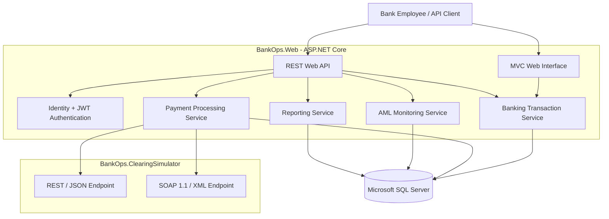

 <p align="center">
  
</p>

<p align="center">
  
</p>

<p align="center">
  <a href="https://github.com/aruna-kariyawasam/BankOps360">
    
  </a>
  
  
  
  
</p>

---

### 🚀 About the Project

**BankOps360** is an independent banking operations and payment integration platform developed using C#, ASP.NET Core, Entity Framework Core, and Microsoft SQL Server.

The project demonstrates how a banking-oriented software system can manage customers, bank accounts, financial transactions, external payment communication, transaction monitoring, and operational reporting through an integrated application architecture.

The platform consists of two main applications and an automated testing project:

- **BankOps.Web** – ASP.NET Core MVC application and REST API.
- **BankOps.ClearingSimulator** – External clearing-bank simulator supporting REST/JSON and SOAP/XML.
- **BankOps.Tests** – Automated integration tests for banking transaction operations.

### ✨ Key Features

#### 🏦 Banking Operations
- Customer registration and management.
- Savings and Current account creation.
- Account information retrieval.
- Deposit and withdrawal operations.
- Internal account transfers.
- Transaction history and audit logging.

#### 💳 Transaction Processing Engine
- Double-entry bookkeeping and ledger recording.
- Atomic database transaction handling.
- Idempotency protection against duplicate requests.
- Optimistic concurrency handling.
- Financial balance validation.
- Transaction reference generation.

#### 🔗 Payment Integration

<p align="center">
  
  
</p>

The clearing simulator demonstrates communication between banking systems using two integration protocols:

- REST API with JSON payloads.
- SOAP 1.1 with XML messages.
- API-key-based service authentication.
- Duplicate payment request protection.
- Accepted and rejected payment responses.
- Compensating ledger entries following payment rejection.
- Handling of uncertain payment-processing outcomes.

#### 🛡️ AML-Style Transaction Monitoring
- High-value transaction detection.
- Frequent transaction activity monitoring.
- Cumulative transaction amount monitoring.
- Risk-score generation.
- Alert review and status management.
- Administrator and Compliance Officer workflows.

#### 📊 Operational Reporting
- Transaction summary reports.
- General ledger reconciliation.
- SQL Server stored procedures.
- Parameterized ADO.NET database queries.

### 🏗️ System Architecture

<p align="center">
  
  
  
</p>



### 🛠️ Technology Stack

<p align="left">
  
  
  
  
  
  
  
  
  
  
  
  
  
  
  
</p>

### 🔐 Application Security

- ASP.NET Core Identity authentication.
- JWT bearer authentication.
- Role-based authorization.
- Password complexity requirements.
- Account lockout policies.
- API rate limiting.
- Clearing-service API-key authentication.
- Security response headers.
- Sensitive development credentials managed with .NET User Secrets.
- Production-only security configuration.

### 🧪 Automated Testing

The project includes an xUnit integration test suite using isolated SQL Server LocalDB databases.

| Test scenario | Expected behaviour |
|---|---|
| Deposit | Account balance increases and ledger entries balance |
| Duplicate deposit | Duplicate request does not post twice |
| Insufficient funds | Withdrawal is rejected |
| Successful withdrawal | Account balance decreases |
| Internal transfer | Source is debited and destination credited |
| Same-account transfer | Invalid transfer is rejected |
| Idempotency conflict | Reusing a key with a different payload is rejected |

<p align="center">
  
  
  
</p>

### 📁 Solution Structure

```text
BankOps360/
│
├── BankOps.Web/
│   ├── Areas/
│   ├── Controllers/
│   │   └── Api/
│   ├── Data/
│   │   └── Migrations/
│   ├── Models/
│   │   └── Banking/
│   ├── Services/
│   ├── Views/
│   ├── Database/
│   │   └── Scripts/
│   └── wwwroot/
│
├── BankOps.ClearingSimulator/
│   ├── Properties/
│   └── Program.cs
│
├── BankOps.Tests/
│   └── BankingTransactionServiceTests.cs
│
├── .gitignore
└── BankOps360.sln
```

### ⚙️ Getting Started

**Prerequisites**

- Visual Studio 2022.
- .NET 8 SDK.
- SQL Server LocalDB.
- Git.

**1. Clone the repository**

```powershell
git clone https://github.com/aruna-kariyawasam/BankOps360.git

cd BankOps360
```

**2. Restore dependencies**

```powershell
dotnet restore
```

**3. Configure development secrets**

Use .NET User Secrets to configure the JWT signing key, development administrator credentials, and matching clearing-service API keys.

The required configuration key names can be checked in `Program.cs`, `IdentitySeeder.cs`, and `ClearingBankClient.cs`.

Do not commit passwords, API keys, signing keys or real connection credentials.

**4. Apply database migrations**

Using Visual Studio Package Manager Console:

```powershell
Update-Database -Project BankOps.Web -StartupProject BankOps.Web
```

**5. Start the clearing simulator**

```powershell
dotnet run --project .\BankOps.ClearingSimulator --no-launch-profile
```

The simulator listens on:

```text
http://localhost:5081
```

**6. Start the main web application**

Open another terminal:

```powershell
dotnet run --project .\BankOps.Web
```

Use the application URL printed by ASP.NET Core in the terminal.

### 🧪 Run Tests

```powershell
dotnet test .\BankOps.Tests\BankOps.Tests.csproj -c Release
```

### ⚠️ Project Scope & Limitations

BankOps360 is an independent software engineering portfolio project and a banking-system simulation.

- The clearing service is a simulator, not a real bank connection or live CEFT/SLIPS integration.
- Payment records in the simulator use in-memory storage and reset when it restarts.
- AML detection thresholds and rules are illustrative, not official regulatory requirements or GoAML certification.
- SQL Server LocalDB and User Secrets are intended for development.
- Production deployment would require further infrastructure, testing, security assessment, operational controls and regulatory review.
- The project currently targets .NET 8 and requires a supported-runtime upgrade before long-term deployment.

### 🔗 Project Repository

<p align="center">
  <a href="https://github.com/aruna-kariyawasam/BankOps360">
    
  </a>
</p>

### 👨‍💻 Developer

<p align="center">
  <a href="https://github.com/aruna-kariyawasam">
    
  </a>
</p>

<p align="center">
  <i>Developed as an independent portfolio project to demonstrate .NET software engineering, financial transaction processing, database development and system integration.</i>
</p>

---
